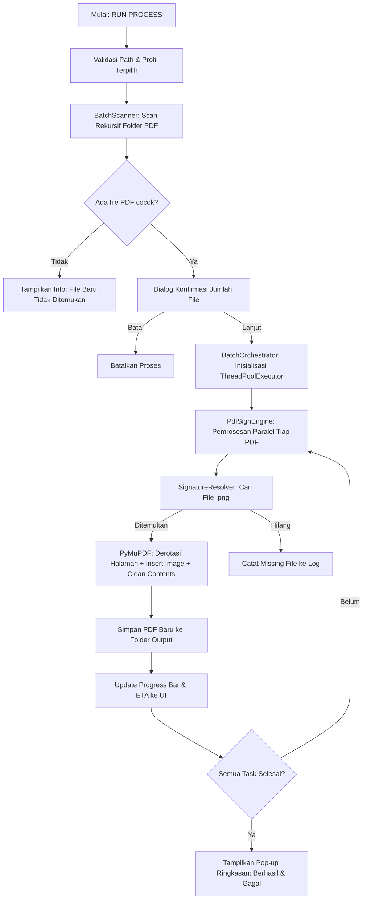

# 🖋️ AutoSign Pro v3 — Dokumentasi Perangkat Lunak Resmi

Aplikasi otomasi penandatanganan dan pembubuhan stempel pada dokumen PDF secara massal (*batch processing*) dengan **Visual Layout Designer**, **Multithreading Concurrency**, dan **Dukungan Multi-Halaman**.

---

## 1. 🛠️ Tech Stack & Dependensi

AutoSign Pro v3 dibangun menggunakan arsitektur modular Python modern yang mengutamakan kecepatan eksekusi, keamanan thread, dan antarmuka responsif:

| Komponen | Pustaka / Teknologi | Versi Target | Peran / Fungsi |
|---|---|---|---|
| **Bahasa Pemrograman** | Python | 3.10+ | Bahasa inti pengembangan sistem |
| **GUI Framework** | `customtkinter` | 5.2+ | Antarmuka pengguna modern dengan tema gelap (*Dark Mode*) & terang (*Light Mode*) |
| **PDF Manipulation Engine** | `PyMuPDF` (`fitz`) | 1.23+ | Ekstraksi halaman, rasterisasi canvas bitmap, derotasi matriks, dan kompresi deflated PDF |
| **Image Processing** | `Pillow` (`PIL`) | 10.0+ | Penanganan format grafis stempel transparansi PNG |
| **Concurrency & Workers** | `concurrent.futures` | Bawaan (Standard) | ThreadPoolExecutor untuk eksekusi paralel multi-core CPU |
| **Logging & Audit Trail** | `logging.handlers.RotatingFileHandler` | Bawaan (Standard) | Pencatatan riwayat eksekusi terpusat ke `autosign.log` dengan rotasi ukuran otomatis |
| **Packaging & Bundling** | `PyInstaller` | 6.x | Kompilasi aplikasi menjadi biner *standalone* Windows (`.exe`) tanpa ketergantungan interpreter Python di komputer pengguna |

---

## 2. ⚡ Fungsi & Fitur Utama

### 1. Otomasi Penandatanganan Massal (*High-Performance Batch Processing*)
- Memproses ratusan hingga ribuan dokumen PDF secara otomatis hanya dengan satu kali klik.
- Mendukung pemindaian rekursif seluruh subfolder di dalam folder *PDF Master*.
- Fitur **Skip Existing Files** untuk efisiensi: secara otomatis melewati file yang sudah pernah diproses di folder *Output*.

### 2. Visual Layout Designer Interaktif
- Dialog visual interaktif untuk menentukan posisi, ukuran bounding box, dan orientasi stempel/tanda tangan di atas lembar PDF asli.
- Fitur interaksi canvas: klik dan seret (*drag-to-move*), resize handle (*drag-to-resize*), edit label, dan hapus kotak terpilih.
- Kontrol perbesaran (*Zoom In / Zoom Out*) dari 20% hingga 250% dengan auto-scroll pan.

### 3. Dukungan Multi-Halaman (*Multi-Page Document Support*)
- Mampu membubuhi stempel pada halaman manapun di dalam dokumen multi-halaman:
  - **Halaman Pertama**: `0`
  - **Halaman Spesifik**: `1`, `2`, dst.
  - **Halaman Terakhir**: `-1` (otomatis mendeteksi lembar akhir pada dokumen berapa pun jumlah halamannya).
- Kontrol navigasi halaman (◀ Prev / Next ▶) langsung di dalam Layout Designer.

### 4. Algoritma Pencarian Cerdas (*3-Tier Smart Signature Resolver*)
Pencarian file gambar stempel/tanda tangan (`.png`) menggunakan hierarki pintar 3 tingkat:
1. **Subfolder Identik**: Mencocokkan struktur subfolder dokumen relatif terhadap root tanda tangan.
2. **Segmen Parent Terdekat (*Reverse Walk*)**: Mencari di subfolder divisi/proyek di atasnya.
3. **Root Master Fallback**: Mengambil tanda tangan umum di folder utama master tanda tangan.

### 5. Multi-Thread Concurrency & In-Memory Caching
- Mengoptimalkan seluruh core CPU untuk memproses banyak PDF secara simultan.
- Thread-safe memory cache: gambar tanda tangan yang sama hanya dibaca dari disk satu kali dan disimpan dalam memori RAM, mempercepat throughput hingga ratusan file per menit.
- Metrik real-time: indikator progres, kecepatan proses (*files/second*), dan estimasi sisa waktu (*ETA*).

### 6. Logging Terpusat & Audit Trail
- Setiap aktivitas sistem, peringatan, maupun kegagalan file dicatat secara otomatis ke file `autosign.log` (maksimal 2MB dengan sistem rotasi 3 file cadangan).

---

## 3. 📐 Penjelasan Arsitektur & Cara Kerja Sistem

### Diagram Alur Pemrosesan Batch


### Penjelasan Modul Kode Sumber (`autosign/`)
- [**`autosign/models.py`**](autosign/models.py): Mendefinisikan struktur data bersih (`SignatureConfig`, `Profile`, `ProcessingTask`, `ProcessResult`, `AppSettings`).
- [**`autosign/services/pdf_engine.py`**](autosign/services/pdf_engine.py): Bertanggung jawab atas manipulasi internal dokumen PDF menggunakan PyMuPDF. Memiliki toleransi terhadap rotasi halaman asli dokumen (`page.rotation * page.derotation_matrix`).
- [**`autosign/services/signature_resolver.py`**](autosign/services/signature_resolver.py): Memetakan posisi file stempel PNG berdasarkan struktur hirarki folder input.
- [**`autosign/services/profile_service.py`**](autosign/services/profile_service.py): Mengelola operasi baca, tulis, salin, dan hapus template konfigurasi profil JSON di folder `profiles/`.
- [**`autosign/services/logger.py`**](autosign/services/logger.py): Mengelola log audit sistem baik ke konsol, file disk, maupun log window GUI.
- [**`autosign/ui/main_window.py`**](autosign/ui/main_window.py): Presenter utama antarmuka pengguna yang reaktif dan bebas dari operasi blocking.

---

## 4. 📖 Tutorial Penggunaan Langkah-demi-Langkah

Untuk panduan lengkap visual dan petunjuk teknis mendalam, silakan baca [Panduan Pengguna (User Manual)](docs/USER_MANUAL.md).

### Langkah 1: Persiapan Struktur Direktori & Tanda Tangan
Siapkan 3 folder utama di komputer Anda:
1. **Folder PDF Master**: Berisi file-file PDF yang ingin ditandatangani (boleh memiliki banyak subfolder).
2. **Folder Master Tanda Tangan**: Berisi file tanda tangan/paraf/stempel berformat `.png` transparan.
   *Contoh nama file*: `TTD_Direktur.png`, `Paraf_Staff.png`, `Stempel_Perusahaan.png`.
3. **Folder Output**: Folder kosong tujuan penyimpanan PDF yang sudah selesai ditandatangani.

---

### Langkah 2: Menjalankan Aplikasi
- **Versi Executable (Standalone Windows)**:
  Unduh biner siap pakai `AutoSign_Pro_v3_Portable.zip` dari menu Releases di GitHub, ekstrak, lalu jalankan `AutoSign_Pro_v3.exe`.
- **Versi Kode Sumber Python**:
  ```powershell
  # 1. Pasang dependensi
  pip install -r requirements.txt

  # 2. Jalankan aplikasi
  python main.py
  ```

---

### Langkah 3: Membuat Profil Tata Letak Tanda Tangan
1. Pada aplikasi, klik tombol **➕ Create New Profile**.
2. Masukkan **Profile Name** (misal: `Profil_Pengesahan_Kecamatan`).
3. Masukkan **Keywords** (kata kunci pencocokan nama file/folder, contoh: `KARTIR, SURAT`).
4. Klik **📂 Load Sample PDF** untuk memuat salah satu file PDF contoh.
5. Gunakan tombol **◀** / **▶** jika ingin menempatkan tanda tangan pada halaman selain halaman pertama.
6. Klik **➕ Add Signature Box**. Masukkan nama file tanda tangan **tanpa ekstensi .png** (contoh: ketik `TTD_Direktur` jika file gambarnya bernama `TTD_Direktur.png`).
7. Kotak biru akan muncul di atas dokumen. Sesuaikan posisi dengan menggesernya (*drag*) atau ubah ukurannya menggunakan handle di sudut kanan bawah kotak.
8. Ulangi langkah di atas jika ada lebih dari 1 tanda tangan/stempel pada dokumen yang sama.
9. Klik **💾 SAVE PROFILE**. Profil akan tersimpan otomatis dan muncul di daftar profil utama.

---

### Langkah 4: Menentukan Path & Menjalankan Proses
1. Pada bagian **📂 Path Configuration**:
   - Klik **Browse** pada *PDF Master* dan pilih folder berisi PDF input.
   - Klik **Browse** pada *Signature Master* dan pilih folder gambar tanda tangan.
   - Klik **Browse** pada *Output Folder* dan pilih folder hasil.
2. Centang profil yang ingin digunakan pada panel **📜 Profile Management** (bisa memilih lebih dari 1 profil sekaligus).
3. Pastikan opsi **Skip existing files** tercentang jika Anda ingin melanjutkan proses sebelumnya tanpa memproses ulang file yang sudah ada.
4. Klik tombol hijau **🚀 RUN PROCESS**.
5. Dialog konfirmasi akan menampilkan jumlah file yang cocok. Klik **Yes** untuk memulai.
6. Pantau kecepatan (*speed*) dan perkiraan selesai (*ETA*) pada status bar.
7. Setelah selesai, klik **📂 OPEN OUTPUT** untuk langsung membuka folder hasil.

---

## 5. ⚠️ Batasan Sistem (*Limitations & Constraints*)

1. **Format File Input Dokumen**:
   - Hanya mendukung dokumen berformat **`.pdf`**. File Word (`.docx`), Excel (`.xlsx`), atau gambar mentah (`.jpg`) harus dikonversi ke PDF terlebih dahulu sebelum diproses.
2. **Format File Gambar Tanda Tangan**:
   - Gambar tanda tangan dan stempel **wajib berformat `.png`**. Format `.jpg` tidak direkomendasikan karena tidak mendukung transparansi latar belakang (*alpha channel*).
3. **Dokumen Terenkripsi / Password-Protected**:
   - Dokumen PDF yang dilindungi kata sandi pengguna (*user password*) tidak dapat diproses sebelum proteksi kata sandi dihilangkan.
4. **Izin Akses Berkas (File Permissions)**:
   - Jika dokumen PDF tujuan sedang terbuka di aplikasi pembaca PDF lain (seperti Adobe Acrobat atau browser Chrome), proses penyimpanan ke file tersebut akan gagal karena adanya *file lock* oleh Windows. Pastikan file PDF tidak sedang dibuka sebelum menjalankan proses.
5. **Kesesuaian Dimensi Lembar Dokumen**:
   - Penempatan stempel menggunakan koordinat relatif proporsional ($0.0 - 1.0$). Jika terdapat dokumen dengan ukuran kertas yang sangat berbeda drastis (misal kombinasi A4 Portrait dan A0 Landscape), disarankan membuat profil khusus untuk masing-masing orientasi dokumen tersebut.
